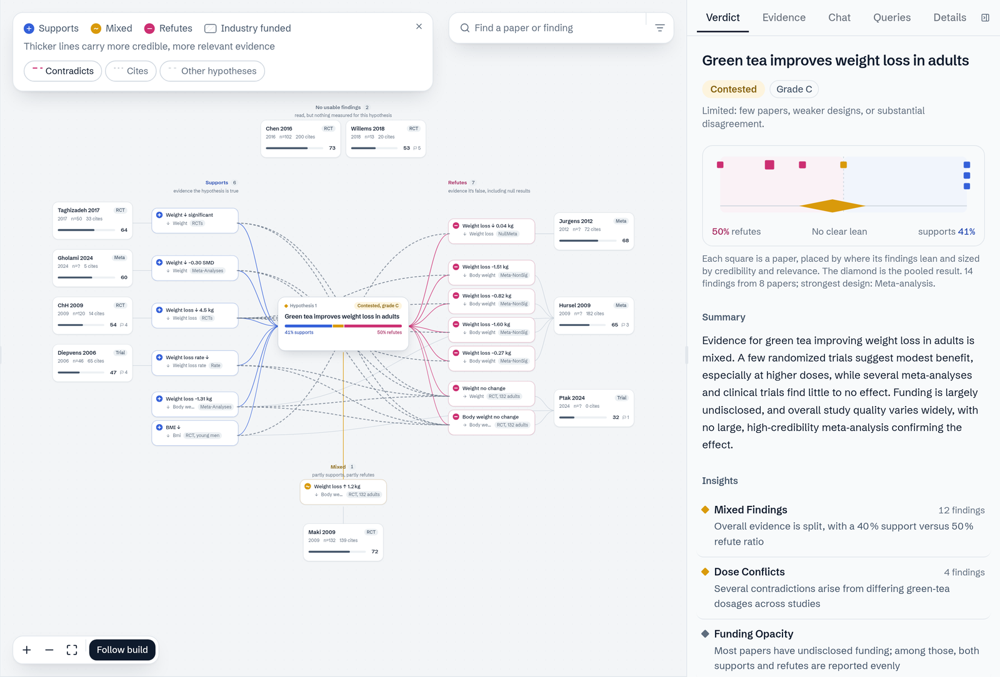
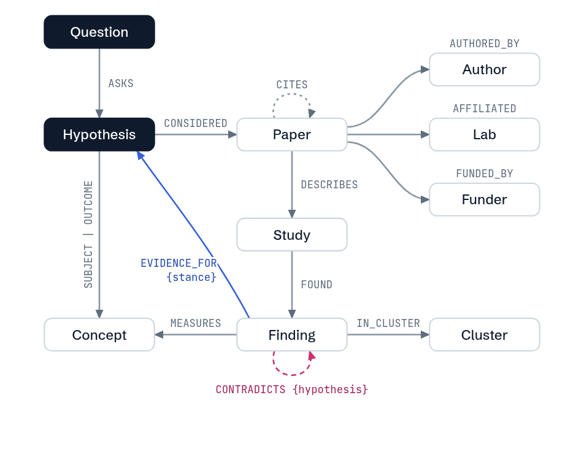

# Nodes Don't Lie

Nodes Don't Lie tells you what the research says about a claim.

You ask a question in plain language, for example "Does green tea help with weight loss?". AI agents then do these steps:

1. They split the question into hypotheses that you can test.
2. They find papers that support or refute each hypothesis.
3. They read each paper and record its studies and findings.
4. They give each paper a credibility score from 0 to 100.
5. They find the places where the evidence disagrees.
6. They give each hypothesis a verdict and a grade from A to D.

All of this goes into one graph in FalkorDB. You see the graph grow while the agents work.



In the graph, findings that support the hypothesis are on the left. Findings that refute it are on the right. Mixed findings are below. A thicker line shows more credible and more relevant evidence. A red dashed line shows two findings that contradict each other.

## Data model



The graph has 10 node types:

| Node | What it is |
|---|---|
| `Question` | The text that the user typed. |
| `Hypothesis` | One claim from the question that we can test, for example "Green tea improves weight loss in adults". |
| `Concept` | A subject, an outcome or a population, for example "green tea" or "body weight". |
| `Paper` | One published paper or trial record. |
| `Study` | One study that a paper describes: its design, size, population and dose. |
| `Finding` | One result of a study, with a direct quote from the paper. |
| `Cluster` | A group of findings that share a context, for example the same dose. |
| `Author`, `Lab`, `Funder` | The people, labs and funders of a paper. |

The relationships:

```
(Question)-[:ASKS]->(Hypothesis)-[:SUBJECT|OUTCOME|POPULATION]->(Concept)
(Hypothesis)-[:CONSIDERED {relevance}]->(Paper)
(Paper)-[:DESCRIBES]->(Study)-[:FOUND]->(Finding)-[:MEASURES]->(Concept)
(Finding)-[:EVIDENCE_FOR {stance, weight, rationale}]->(Hypothesis)
(Finding)-[:CONTRADICTS {hypothesis, reason, explained_by}]->(Finding)
(Finding)-[:IN_CLUSTER]->(Cluster)-[:OF]->(Hypothesis)
(Paper)-[:AUTHORED_BY]->(Author)
(Paper)-[:AFFILIATED]->(Lab)
(Paper)-[:FUNDED_BY]->(Funder)
(Paper)-[:CITES]->(Paper)
```

### Why the model has this shape

**The stance is on the edge, not on the finding.** A finding does not "support" by itself. It supports one hypothesis. The same finding can be irrelevant to a different hypothesis. Thus we put `stance` and `weight` on the `EVIDENCE_FOR` edge.

**A contradiction belongs to one hypothesis.** Two findings can disagree about weight loss but agree about safety. Thus each `CONTRADICTS` edge records its hypothesis. We index that property, so a query for one hypothesis reads only its contradictions.

**All questions share papers, studies and findings.** A paper goes into the graph one time only. When a new question needs the same paper, the agents use the stored studies and findings. They do not read the paper again. This makes later questions faster and less expensive.

**The same meaning gives the same key.** The key of a hypothesis comes from its subject, outcome and population. Two questions with different words but the same meaning get the same key. The second question then uses the research of the first.

**Different names for one outcome go to one concept.** One paper says "lean body mass" and a different paper says "muscle mass". The Stance agent checks if a finding measures the same outcome as the hypothesis. If it does, the finding gets a `MEASURES` edge to the hypothesis's concept, and the new name goes into the concept's `synonyms`.

**A finding knows its paper.** Each `Finding` has a `paper_id` property. A query can go from a finding to its paper in one step. It does not have to go through the `Study` node. This makes the most frequent queries 2 or 3 hops shorter.

### What is not in the graph

Paper abstracts, verdict text, run logs and caches are in Redis. The graph keeps only the evidence and its links.

## The queries

The **Queries** tab runs five queries on each question. It shows the result, the number of hops and the time. Each query answers a question that a reader of research asks. In a relational database, each query needs 3 to 6 joins. In the graph, each one is one pattern.

### 1. Funding trail (3 hops)

**The question:** Who paid for the evidence on each side?

**Why:** Industry funding can change the result of a study. If most of the support for a claim comes from companies that sell the product, the reader must know this.

```cypher
MATCH (:Question {id:$q})-[:ASKS]->(h:Hypothesis)<-[e:EVIDENCE_FOR]-(x:Finding)
MATCH (p:Paper {id:x.paper_id})
OPTIONAL MATCH (p)-[:FUNDED_BY]->(f:Funder)
RETURN h.statement AS hypothesis, coalesce(f.type, 'undisclosed') AS funder_type,
       e.stance AS stance, count(DISTINCT p) AS papers
```

### 2. Who contradicts whom (4 hops)

**The question:** Which labs get results that disagree with which other labs, and why?

**Why:** A disagreement is often not an error. The two studies can use different doses or different populations. The `explained_by` field shows this difference. A disagreement with no explanation is a real gap in the research.

```cypher
MATCH (:Question {id:$q})-[:ASKS]->(h:Hypothesis)
MATCH (a:Finding)-[c:CONTRADICTS]->(b:Finding) WHERE c.hypothesis = h.key
MATCH (pa:Paper) WHERE pa.id = a.paper_id
MATCH (pb:Paper) WHERE pb.id = b.paper_id
OPTIONAL MATCH (pa)-[:AFFILIATED]->(la:Lab)
OPTIONAL MATCH (pb)-[:AFFILIATED]->(lb:Lab)
RETURN pa.label, la.name, pb.label, lb.name, c.reason, c.explained_by
```

### 3. Evidence used again across hypotheses (3 hops)

**The question:** Which papers give evidence for more than one hypothesis in the graph?

**Why:** This shows that the shared model works. It also shows the papers that are central to a field.

```cypher
MATCH (:Question {id:$q})-[:ASKS]->(:Hypothesis)-[:CONSIDERED]->(p:Paper)
MATCH (p)<-[:CONSIDERED]-(h:Hypothesis)
WITH p, collect(DISTINCT h.statement) AS hypotheses
WHERE size(hypotheses) > 1
RETURN p.label, p.title, hypotheses
```

### 4. Citation reach (up to 4 hops)

**The question:** Which papers do our papers cite, directly or through a chain of up to 3 citations?

**Why:** A paper that many of our papers cite is probably a key paper. If that paper is weak, much of the evidence rests on a weak base.

```cypher
MATCH (:Question {id:$q})-[:ASKS]->(:Hypothesis)-[:CONSIDERED]->(a:Paper)
MATCH (a)-[:CITES*1..3]->(b:Paper)
RETURN b.label AS paper, count(DISTINCT a) AS reached_from, max(b.credibility) AS credibility
ORDER BY reached_from DESC
```

### 5. Shared researchers (5 hops)

**The question:** Which authors also wrote papers about other hypotheses in the graph?

**Why:** A small group of authors can produce much of the evidence in a field. This can be a sign of a strong research group. It can also be a sign that the evidence is less independent than it looks.

```cypher
MATCH (:Question {id:$q})-[:ASKS]->(h:Hypothesis)-[:CONSIDERED]->(:Paper)-[:AUTHORED_BY]->(a:Author)
MATCH (a)<-[:AUTHORED_BY]-(:Paper)<-[:CONSIDERED]-(o:Hypothesis)
WHERE o.key <> h.key
RETURN a.name AS author, collect(DISTINCT o.statement)[..3] AS other_hypotheses
```

### Graph algorithms

The chat and the MCP server (`/mcp`) also use FalkorDB's graph algorithms:

| Tool | Algorithm | The question it answers |
|---|---|---|
| `trace_path` | `algo.SPpaths` | How does this paper connect to that hypothesis? |
| `influential_papers` | PageRank, betweenness, harmonic centrality on `CITES` | Which papers does the rest of the evidence depend on? |
| `contradiction_clusters` | `algo.WCC` on `CONTRADICTS` | Where does the evidence split into groups that disagree? |
| `explain_verdict` | A multi-hop query, grouped by stance | Why did this hypothesis get its verdict? |

All queries from the chat and the console are read-only. They use `GRAPH.RO_QUERY`, a 3-second limit and a row limit.

## Run it

You need Docker, Python 3.13 with `uv`, Node.js and an Anthropic API key.

```bash
docker compose up -d                 # FalkorDB on port 6380, Redis on port 6381
export ANTHROPIC_API_KEY=...
cd backend && ./run.sh               # the API on port 8100
cd frontend && npm install && npm run dev -- -p 3100
```

Open http://localhost:3100. To try it without an API key, click **Watch demo**. The demo plays back a recorded run.

All settings start with `TG_`. They are in `backend/app/config.py`.

Nodes Don't Lie does not give medical advice. Each verdict shows its evidence grade.
